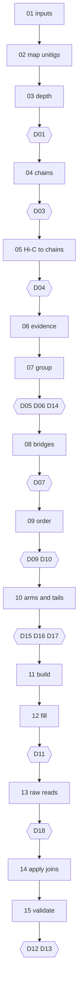

# The process, start to end

## The whole run

1. **Before starting,** check the inputs: `p_utg` FASTA and GFA from the same hifiasm run, corrected reads, Hi-C, and raw BAMs if you have them. Know the chromosome number and ploidy, and ask the user if unsure. Tell the user which read sets must stay on disk until the end: stages 02, 04, 06, 08, 12, 13 and 15 use reads. Set `compute.guard_path` to the drive that fills first.
2. **Run and decide, in a loop.** `agentssembler run WORK` stops at each decision. Read the report and guide, inspect the evidence, put any change in an `edits/` file with its reason, record the decision, and run again. A report's alarm is a prompt to look, not a verdict.
3. **Go back when evidence says to.** `agentssembler reset WORK STAGE` undoes that stage and everything after it. It is often cheaper than it looks: mappings stay unless `--remap`. Busk went back from validation to fork breaks at stage 06, and that took h1's missing genes from 19 to 7.
4. **Hand over at D13.** Give the user the final AGP and FASTA, unplaced sequence, Juicebox files, SV table, curation targets, every open choice with your recommendation, and the limits of the result. Stop there: adoption and risk are theirs.

**Finished means:** `15_final_raw/` (or `15_final/` without raw reads) holds the assembly, `16_validate/` its evidence, `decisions/` and `edits/` every judgement with its reason, and D13 records the user's answer in their words.

**Reusing mappings from an earlier build.** Link them into the new work directory before `run`, since a step skips when its output exists, and the costly stages then take minutes. `tests/specs/*.yaml` list the files.

- **Unitig-level mappings** (stages 02) depend only on the inputs, so they are always reusable.
- **Chain-level mappings** (stages 04, 05, 06) are reusable only if the chains are identical. Compare `chains.fasta` first: a code fix upstream can change them (T16).
- **Mappings to scaffolds** (stages 12, 13, 15) are reusable only for the same scaffolds.

**Do not reuse an earlier build's edit files without rereading them.** Chain and group labels can change, and each edit answered a question about that build.

## The stages

Each stage is a bash script in `stages/`. Each writes `reports/STAGE.md` and logs to `logs/STAGE.log`. Outputs go in numbered directories in the work directory. The check under each stage is the question to ask; the numbers are from the genomes tried, so expect yours to differ.

Steps skip when their output exists, and costly mappings write to `.part` until complete. **To map elsewhere, such as an HPC,** run `agentssembler env WORK` to get the environment, run the stage script there or just its mappings, then put the outputs in place.

## 01_inputs

Links inputs, indexes them, checks tools, and checks `unitigs.gfa` against `unitigs.fasta`.

**Check:** every read set is complete. A truncated read file looks like low depth later.

## 02_map_unitigs (hours)

Corrected reads to all unitigs, with base-level alignment and near-equal secondaries. Unitigs against themselves, to find alleles and near-identical twins. Unitigs to the reference, as an alarm.

## 03_depth, then D01

Primary depth per unitig, and sequence-class depth adding near-identical copies. Class depth over haplotype depth is the number of haplotypes carrying a sequence.

## 04_chains, then D03 (1-3 h)

1. **Copy number and kept set.** Longest first; a unitig is redundant when its windows already have enough copies among kept unitigs. Unique sequence is never dropped. 13Q010: 2,305 unitigs (1,101 Mb) to 1,507 (1,027 Mb).
2. **First chains** along unambiguous graph links.
3. **Round 2.** Drops contained and high-copy chains, and adds exact end-to-end overlaps as links. 13Q010: 567 chains to 273.
4. **Join verification.** Reads across every join. Under 3 reads breaks it.
5. **Restored arms** if collapsed. Arms next to a collapsed node were dropped because reads land on the node, which loses an allele. They return in stage 06.

## 05_hic_chains, then D04 (about 1.6 h)

Hi-C to the final chains, keeping pairs at MAPQ >= 1 and NM < 3. Mapping to chains rather than unitigs gave 17% more pairs on 13Q010, recovering contacts lost at unitig ends. Do not skip it. The target also holds every unitig stage 04 set aside as high-copy, named `decoy_*`, so that organelle reads do not land on nuclear insertions as if unique (see [LESSONS](LESSONS.md)); pairs touching a decoy are dropped. `reset 05_hic_chains --remap` is needed to redo the mapping, since `09_hic_map` is kept otherwise.

## 06_evidence (about 40 min)

Applies D04 breaks without remapping Hi-C. Restores **connectors**: dropped unitigs that are the graph path between two chain ends (`restore_connectors: true`). Unused ones are dropped again at `11_build`. Then gathers everything grouping needs: reads to the broken chains, allele table, Hi-C density, repeat fraction, telomeres, graph and read links at chain ends, and depth class.

## 07_group, then D05, D06, D14

Hi-C clustering under the allele-conflict constraint: two chains that are alleles cannot share a group. Diploids use `hap_first`, because chromosome-first clustering failed on divergent homologs. If collapsed, also scans for chains running through a fork (`10_groups/chain_forks.txt`), which cannot be seen until groups exist. **Check:** chromosomes x ploidy groups, bridges within groups, at most 2 telomeric ends each, and any `HUB` rows: a break costs a read mapping, so settle them before ordering.

## 08_bridges, then D07

Applies group edits. If collapsed, writes one copy of each shared chain per haplotype and rewrites groups, AGP, pairs, links, stats and telomeres. Finds graph paths between group ends, up to `hops` steps (12 by default), and ranks them with read support.

## 09_order, then D09, D10 (minutes to 70 min)

Orders each chromosome's groups in parallel. Hi-C sets the base score. Graph and read links, and telomeres, carry a bonus large enough to act as near-hard constraints, which follows from the evidence order. The reference check is an alarm, and `unhonoured.py` tests order without a reference.

## 10_arms_tails, then D15, D16, D17

Sets names, chooses arms at bridges (jointly if collapsed), builds once, then lists one-sided tails and tests them. Names are conventions: `<chrom>_h<k>`, with arbitrary haplotype numbers, and `flip` writes a scaffold in the reference's direction only. **Nothing here changes layout except accepted tails.**

## 11_build

Writes scaffolds, junctions, placements and unplaced sequence. Chains with too little Hi-C to place are left unplaced. **Check:** `build_scaffolds` places a chain by density within it, not evidence for its position, so run `scripts/review/weak_placed.py`.

## 12_fill, then D11 (about 1 h)

**Freeze the order first: this mapping is costly.** Reads across gaps with unique anchors in both flanks, agreeing with each other. If collapsed: two masked targets, since reads cannot anchor over sequence present twice, a fill per haplotype, and no `--target`, since excision would treat true shared copies as false duplication.

**Check:** sum of AGP sequence and gaps equals FASTA length. Most gaps stay open, and that is correct: most gaps have no spanning read. The report lists scaffolds much shorter than their homolog, and gap edges whose read tails mostly enter one unplaced sequence (`14_readfill/gap_tails.tsv`). Both are prompts to look behind the gap ([D11](decisions/D11_gap_closures.md)), not grounds to place anything.

## 13_rawreads, then D18 (1-2 h; optional)

Streams raw reads into minimap2 against the same targets as the corrected reads. Compares them at gaps and control sites, extracts reads near gaps, re-fills, and audits every read-derived join, old and new. Repeats the tail scan with raw reads (`17_raw_reads/gap_tails.tsv`), since correction loses reads near gaps.

## 14_apply_joins

Writes `15_final_raw/`, leaving `15_final/` as it was.

## 15_validate, then D12, D13 (about 1.5 h)

On the final files only: size and N50, telomeres, dosage against the reference, Hi-C lifted to final coordinates, contact maps and crosstalk, phase scan, depth by class, homolog alignments and inverted blocks with breakpoint evidence, tail joins, connected unplaced tangles (`unplaced_components.txt`), Juicebox files, and compleasm **on the unplaced sequence too**. On WatsonsChoice, genes in unplaced sequence and missing from both haplotypes first exposed a real ordering bug. **Read `compleasm/complement.txt` before the per-haplotype scores.** Haplotype numbers are arbitrary across chromosomes, so with translocations "all h1 scaffolds" is not a complete set: 13Q010 went from 91.84, 98.18 and 93.73% to 99.32, 99.50 and 98.82% by numbering alone.
