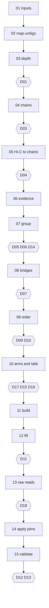

# The process, start to end

## The whole run

1. **Before starting,** check the inputs: `p_utg` FASTA and GFA from the same hifiasm run, corrected reads, Hi-C, and raw reads if you have them. Know the chromosome number and ploidy, and ask the user if unsure. For a polyploid or an inbred sample, what to enter is not always the textbook figure ([SETTINGS](SETTINGS.md)). Tell the user that every input must stay on disk until the end: `agentssembler run` checks all the inputs in `config.yaml` before it starts any stage. Corrected reads are used by stages 02, 04, 06, 08, 12 and 15, Hi-C reads by stage 05, and raw reads by stage 13. Set `compute.guard_path` to the drive that fills first.
2. **Run and decide, in a loop.** `agentssembler run WORK` stops at each decision. Read the report and guide, inspect the evidence, put any change in an `edits/` file with its reason, record the decision, and run again. A report's alarm is a prompt to look, not a verdict.
3. **Go back when evidence says to.** `agentssembler reset WORK STAGE` undoes that stage and everything after it, keeping what it replaces in `WORK/archive/<timestamp>/`. Do not copy a directory to a `_v2` name instead ([LAYOUT.md](LAYOUT.md), "Re-running"). It is often cheaper than it looks: mappings stay unless `--remap`. Busk went back from validation to fork breaks at stage 06, and that took h1's missing genes from 19 to 7.
4. **Hand over at D13.** Give the user the final AGP and FASTA, unplaced sequence, Juicebox files, SV table, curation targets, every open choice with your recommendation, and the limits of the result. Propose here anything outside the process that might help this assembly, with its evidence; the user decides whether to trial it. Stop there: adoption and risk are theirs.

**Finished means:** `15_final_raw/` (or `15_final/` without raw reads) holds the assembly, `16_validate/` its evidence, `decisions/` and `edits/` every judgement with its reason, D13 records the user's answer in their words, and `README.md` in the work directory is filled in.

**Reusing mappings from an earlier build.** Link them into the new work directory before `run`, since a step skips when its output exists, and the costly stages then take minutes. `tests/specs/*.yaml` list the files.

- **Unitig-level mappings** (stages 02) depend only on the inputs, so they are always reusable.
- **Chain-level mappings** (stages 04, 05, 06) are reusable only if the chains are identical. Compare `chains.fasta` first: a code fix upstream can change them (T16).
- **Mappings to scaffolds** (stages 12, 13, 15) are reusable only for the same scaffolds.

**Do not reuse an earlier build's edit files without rereading them.** Chain and group labels can change, and each edit answered a question about that build.

## The stages

Each stage is a bash script in `stages/`. Each writes `reports/STAGE.md` and logs to `logs/STAGE.log`. Outputs go in numbered directories in the work directory, **whose numbers are not the stage numbers**: [LAYOUT.md](LAYOUT.md) maps each stage to its directories and lists every file. The check under each stage is the question to ask; the numbers are from the genomes tried, so expect yours to differ.

Steps skip when their output exists, and costly mappings write to `.part` until complete. **To map elsewhere, such as an HPC,** follow [HPC.md](HPC.md): `agentssembler env WORK` gives the environment, the stage script runs there, and the outputs are put in place.

## 01_inputs (about 1 h with compleasm, else seconds)

Links inputs, indexes them, checks tools, and checks `unitigs.gfa` against `unitigs.fasta`. **Genes on the unitigs** (compleasm, when set): what the assembly could hold, in `01_genes/`. Stages 05, 07 and 10 lift these hits onto chains, so D04, D05 and D16 can say how many genes a choice gains or loses without running compleasm again. On 292 the unitigs held 99.7% of genes while the first build placed 92%: the shortfall was placement, and this is the earliest place to see the ceiling. It runs first so that a wrong compleasm path or lineage stops the run before hours of mapping; `reset` keeps it unless `--remap`.

**Check:** every read set is complete. A truncated read file looks like low depth later.

## 02_map_unitigs (hours)

Corrected reads to all unitigs, with base-level alignment and near-equal secondaries. Unitigs against themselves, to find alleles and near-identical twins. Unitigs to the reference, as an alarm.

**Memory:** these mappings have taken up to 50 GB. minimap2's memory grows with `-t`, and the unitig self-alignment (`-N 20`) is the largest. If the stage is killed by the OOM killer (`dmesg`, or exit 137), delete the `.part` file and run the stage again with fewer threads: `AS_THREADS=6` held 292's self-alignment to 21.7 GB on a 30 GB machine. Use the driver's environment (`agentssembler env`, as in [HPC](HPC.md)), and record the thread count in the work directory's `README.md`.

## 03_depth, then D01

Primary depth per unitig, and sequence-class depth adding near-identical copies. Class depth over haplotype depth is the number of haplotypes carrying a sequence.

## 04_chains, then D03 (1-3 h)

1. **Copy number and kept set.** Longest first; a unitig is redundant when its windows already have enough copies among kept unitigs. Unique sequence is never dropped. 13Q010: 2,305 unitigs (1,101 Mb) to 1,507 (1,027 Mb).
2. **First chains** along unambiguous graph links.
3. **Round 2.** Drops contained and high-copy chains, and adds exact end-to-end overlaps as links. 13Q010: 568 chains to 274.
4. **Join verification.** Reads across every join. Under 3 reads breaks it.
5. **Restored arms** if collapsed. Arms next to a collapsed node were dropped because reads land on the node, which loses an allele. They return in stage 06.
6. **Length scale.** Mean chromosome length over 36 Mb, measured from the final chains and kept for the build. It multiplies the chromosome-scale windows of later stages ([SETTINGS](SETTINGS.md)). The report gives it, and an alarm when it is far from the citrus value of about 1.

## 05_hic_chains, then D04 (about 1.6 h)

Hi-C to the final chains, keeping pairs at MAPQ >= 1 and NM < 3. **This is the only Hi-C mapping, and the driver runs it** (`bwa mem -5SP`, `samblaster`, then `scripts/hic_pairs.py`, which keeps pairs as HapHiC's `filter_bam` did): there is no earlier Hi-C step (`01_genes/` is compleasm on the unitigs). The target also holds every unitig stage 04 set aside as high-copy, named `decoy_*`, so that organelle reads do not land on nuclear insertions as if unique ([RECORD](RECORD.md), "Organelle Hi-C on nuclear insertions"); pairs touching a decoy are dropped. `reset 05_hic_chains --remap` is needed to redo the mapping, since `09_hic_map` is kept otherwise.

**Hi-C allele rescue, decided at D04.** Whatever the setting, this stage also keeps pairs with an allele-ambiguous end, and lists the Hi-C-blind chains that grouping will leave unassigned (`09_hic_map/rescue_signal.txt`, with their gene copies). At ploidy 2 only, deciding `hic_allele_rescue` here costs nothing (above it the driver refuses the setting); later it costs `reset 07_group` or more ([D04](decisions/D04_chimeric_chains.md)). If collapsed, the stage also lists collapsed hubs on the chains D04 will break (`10_groups/hub_cores.d04.tsv`), so their breaks go in with the chimera breaks.

## 06_evidence (about 40 min)

Applies D04 breaks without remapping Hi-C. Restores **connectors**: dropped unitigs that are the graph path between two chain ends (`restore_connectors: true`). Unused ones are dropped again at `11_build`. Then gathers everything grouping needs: reads to the broken chains, allele table, Hi-C density, repeat fraction, telomeres, graph and read links at chain ends, and depth class. The driver then measures the library's Hi-C density H and sets `min_within` to 0.13 x H for the rest of the build ([SETTINGS](SETTINGS.md)).

## 07_group, then D05, D06, D14

With `hic_allele_rescue`, chains left unassigned are placed by allele-ambiguous Hi-C (`10_groups/groups.rescued.tsv`); the chains it leaves out, and why, are in [D04](decisions/D04_chimeric_chains.md). Without it, the same step runs on a copy (`10_groups/rescue_preview/`) and the report says what it would place. With genes on the unitigs, `10_groups/genes_placed.txt` counts genes short of a copy and those the rescue, or its preview, makes whole.

Hi-C clustering under the allele-conflict constraint: two chains that are alleles cannot share a group. Diploids use `hap_first`, because chromosome-first clustering failed on divergent homologs. Above ploidy 2, shared chains also get a dosage: which of the haplotypes carry them ([D14](decisions/D14_shared_chains.md)). If collapsed, also scans for chains running through a fork (`10_groups/chain_forks.txt`), which cannot be seen until groups exist. **Check:** chromosomes x ploidy groups, bridges within groups, at most 2 telomeric ends each, and any `HUB` rows: a break costs a read mapping, so settle them before ordering.

## 08_bridges, then D07

Applies group edits. If collapsed, writes one copy of each shared chain per haplotype and rewrites groups, AGP, pairs, links, stats and telomeres. Finds graph paths between group ends, up to `hops` steps (12 by default), and ranks them with read support.

## 09_order, then D09, D10 (minutes to 70 min)

Orders each chromosome's groups in parallel. Hi-C sets the base score. The search climbs from a greedy order, then restarts from random orders until 3 in a row fail to improve (at most 40); time grows steeply with chains per group, so the patience rule keeps a group of 50 chains to minutes. Graph and read links, and telomeres, carry a bonus large enough to act as near-hard constraints, which follows from the evidence order. The reference check is an alarm, and `unhonoured.py` tests order without a reference.

## 10_arms_tails, then D17, D15, D16

Sets names, chooses arms at bridges (jointly if collapsed), builds once, then lists one-sided tails and tests them. Names are conventions: `<chrom>_h<k>`, with arbitrary haplotype numbers, and `flip` writes a scaffold in the reference's direction only. To set names yourself, copy `13_scaffold/names.tsv` to `edits/names.tsv`, change it, and `reset WORK 10_arms_tails`. **Nothing here changes layout except accepted tails.**

**Check, before tails (D16):** the tangle check ([TANGLES.md](TANGLES.md)).

- If collapsed, `12_shared/chain_forks.tsv` lists `LOST` rows. In each, a placed or tail chain runs through a 2x hub, and the hub's other exit reaches an unplaced 1x chain. The report names them.
- Look for tails that stop inside a small tangle short of unplaced telomeric chains.
- With `hic_allele_rescue`, `12_shared/rescue_swaps.tsv` lists Hi-C gaps that swapping two chains between homologs would close ([D16](decisions/D16_tails.md)).

**Direction:** `12_shared/homolog_direction.tsv` compares each pre-build scaffold with its first homolog. The report flags one written in reverse: list it in `edits/flip.txt` now, which stage 12 applies before mapping reads ([D12](decisions/D12_sv_calls.md)). Stage 11 has no stop, so this is the last stop before stage 12.

**Genes on tails:** with genes on the unitigs, `12_shared/tail_genes.tsv` gives each tail's genes and how many have no full set of placed copies elsewhere. They make a tail worth testing; they do not pass it ([D16](decisions/D16_tails.md)).

A break or a TTT result goes in as edits, followed by a `reset` back (`06_evidence --remap` for a break). Doing it here costs a stage-06 mapping, against stages 12-15 if it is found after validation. On GammaCitrus both chr5 telomeric arms and a 779 kb lost allele were behind such forks.

## 11_build

Writes scaffolds, junctions, placements and unplaced sequence. Chains with too little Hi-C to place are left unplaced. **Check:** `build_scaffolds` places a chain by density within it, not evidence for its position, so run `scripts/review/weak_placed.py`. It repeats stage 10's direction check with the tails (`13_scaffold/homolog_direction.tsv`). Stage 11 does not stop, so `run` goes on to stage 12: a flag raised only here is acted on at D11, for `reset 12_fill` ([D12](decisions/D12_sv_calls.md)).

## 12_fill, then D11 (about 1 h)

**Freeze the order first: this mapping is costly.** Reads across gaps with unique anchors in both flanks, agreeing with each other. If collapsed: two masked targets, since reads cannot anchor over sequence present twice, a fill per haplotype, and no `--target`, since excision would treat true shared copies as false duplication.

**Check:** sum of AGP sequence and gaps equals FASTA length. Most gaps stay open, and that is correct: most gaps have no spanning read. The report lists scaffolds much shorter than their homolog, and gap edges whose read tails mostly enter one unplaced sequence (`14_readfill/gap_tails.tsv`). Both are prompts to look behind the gap ([D11](decisions/D11_gap_closures.md)), not grounds to place anything.

## 13_rawreads, then D18 (1-2 h; optional)

Streams raw reads into minimap2 against the same targets as the corrected reads. Compares them at gaps and control sites, extracts reads near gaps, re-fills, and audits every read-derived join, old and new. Repeats the tail scan with raw reads (`17_raw_reads/gap_tails.tsv`), since correction loses reads near gaps.

## 14_apply_joins

Writes `15_final_raw/`, leaving `15_final/` as it was.

## 15_validate, then D12, D13 (about 1.5 h)

On the final files only: size and N50, telomeres, dosage against the reference, Hi-C lifted to final coordinates, contact maps and crosstalk, phase scan, depth by class, homolog alignments and inverted blocks with breakpoint evidence, tail joins, connected unplaced tangles (`unplaced_components.txt`), Juicebox files, and compleasm **on the unplaced sequence too**. Genes in unplaced sequence and missing from every haplotype point to an ordering or placement error ([D09](decisions/D09_order.md)). The report raises an alarm when a haplotype is under `compleasm.min_complete` (95%) complete, or when more than 1% of gene copies are short on the scaffolds and some of those genes are complete in unplaced sequence. At ploidy 2 it also writes **unlocalized scaffolds** (`unloc/`: chromosome known, position not), which are part of the assembly handed over ([D13](decisions/D13_user_decisions.md)). **Read `compleasm/complement.txt` before the per-haplotype scores:** haplotype numbers are arbitrary across chromosomes, so with translocations "all h1 scaffolds" is not a complete set ([RECORD](RECORD.md), "Gene sets across translocations").
